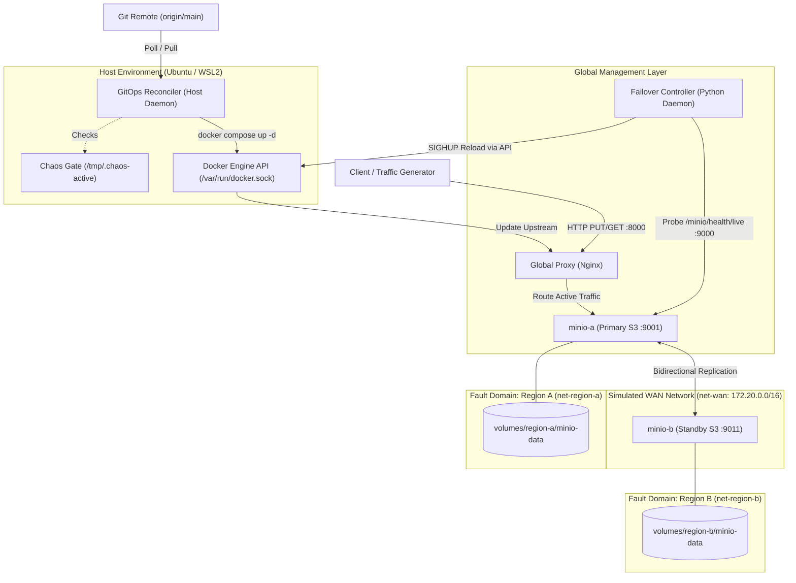

# Multi-Region HA Data Platform Simulation

Local multi-region High Availability (HA) data platform simulation on a single Linux machine (WSL2 Ubuntu) using Docker Compose.

The platform simulates two independent fault domains (`region-a` and `region-b`), each on its own isolated Docker network, with cross-region replication passing across a simulated inter-region WAN network (`net-wan`).

---

## Architecture Overview



### Components
1. **Region A & B MinIO Storage:** Single-node S3-compatible instances with versioned buckets (`data-bucket`).
2. **Replication Strategy:** Bidirectional active-active bucket replication using dedicated service accounts over `net-wan`. By default, replication operates in **asynchronous mode** for low write latency (~3.8ms), with synchronous mode (`--sync enable`) available as a configuration option that enforces dual-node persistence while the remote peer is healthy.
3. **Global Proxy & Failover:** Edge Nginx reverse proxy routing traffic to the active region with automated failover controller tracking Recovery Time Objective (RTO = ~3.49s).
4. **GitOps Reconciler:** Continuous host-based reconciler running from an isolated clone (`~/deploy/SWFW_5S_02`) watching `origin/main` for drift management and chaos gating.

---

## Known Shortcuts & Architecture Notes

> [!NOTE]
> **Container User Permissions (`user: "0:0"`):**
> MinIO containers in `docker-compose.yml` run as `user: "0:0"` (root). By default, Chainguard MinIO images run under non-root UID 65532. Because host volume mounts on WSL2 can default to differing UID/GIDs, running as root is used as an intentional development shortcut to prevent host bind-mount permission conflicts across Linux/WSL environments. In a production deployment, directory permissions should instead be pre-chowned to UID 65532 with non-root security contexts enforced.

> [!NOTE]
> **Docker Socket Access (`/var/run/docker.sock`):**
> The failover controller container mounts `/var/run/docker.sock` to issue SIGHUP reload signals directly to the Nginx proxy container over the Docker Engine API. This avoids running heavy Docker CLI binaries or SSH daemons inside the controller.

> [!IMPORTANT]
> **Manual Failback by Design:**
> While failover from Region A to Region B is completely automated upon detecting consecutive healthcheck probe failures, **failback to Region A is intentionally manual**. This prevents cluster flapping, split-brain scenarios, and accidental traffic restoration before cross-region replication queues have completely caught up. Failback is executed safely via `scripts/chaos/failback.sh`.

> [!WARNING]
> **Failover Demotion & False-Positive Divergence Risk:**
> Upon initiating automated failover, the failover controller removes Region B's replication rule (`mc replicate rm local/data-bucket --all --force`) via the Docker socket. This demotes Region B to standalone mode so client writes never hang or block even if synchronous replication was active. Consequently, if a **false-positive failover** occurs (e.g. transient probe packet loss while Region A was actually still running and accepting client writes), both regions will accept independent writes and **diverge** until an operator intervenes and executes `scripts/chaos/failback.sh` to trigger bidirectional resync and merge object histories.

> [!NOTE]
> **Synchronous vs. Asynchronous Replication Guarantees:**
> - **Synchronous Mode (`--sync enable`):**
>   - **When zero loss is guaranteed:** While the remote peer is healthy and reachable, PUT requests block until the replica is committed on both nodes (~6ms to 9ms latency), guaranteeing zero data loss (RPO = 0).
>   - **Can sync ever ack a write the peer doesn't have? YES:** Under a network partition, the first write hangs for MinIO's internal replication connection timeout (~65s). If the client times out, the object is still committed locally on Region A (in-doubt/ambiguous write). Crucially, once the ~65s timeout trips, MinIO flags the peer as degraded/offline and **silently degrades to local-only asynchronous acknowledgement** for subsequent writes, returning HTTP 200 (~4ms) even though the peer has not received the data. If Region A crashes before the link heals and queues resync, those client-acknowledged writes are lost on failover (measured RPO = 1 object).
> - **Asynchronous Mode (`--sync disable`):** Prioritizes write availability (AP mode) with ~4ms PUT latency. If the primary crashes while replication lag exists, writes remaining in the replication backlog buffer prior to the crash are lost upon failover (measured RPO of 14 objects under lag-injection).

---

## Getting Started

### 1. Environment Configuration
Copy the reference template and define local credentials:
```bash
cp .env.example .env
```
Ensure `.env` contains non-default passwords. `.env` is strictly excluded from version control via `.gitignore`.

### 2. Launch the Platform
```bash
docker compose --profile all up -d
```

### 3. Verify Replication Status
```bash
docker exec minio-a mc replicate status local/data-bucket
```

---

## Endpoints

| Service | Host Port | Purpose |
| :--- | :--- | :--- |
| **Global Entrypoint** | `http://localhost:8000` | High-availability active proxy (Nginx) |
| **Region A S3 API** | `http://localhost:9001` | Direct API endpoint for Region A |
| **Region A Console** | `http://localhost:9002` | MinIO Web UI Console for Region A |
| **Region B S3 API** | `http://localhost:9011` | Direct API endpoint for Region B |
| **Region B Console** | `http://localhost:9012` | MinIO Web UI Console for Region B |

---

## Live Demo Runbook (End-to-End Walkthrough)

To demonstrate the complete platform lifecycle live—from fresh clone to automated failover, true RPO measurement, disaster recovery failback, and GitOps drift self-healing—run these 8 commands in order:

```bash
# 1. Clone into isolated deploy directory and enter repository
git clone https://github.com/varad016/SWFW_5S_02.git ~/deploy/SWFW_5S_02 && cd ~/deploy/SWFW_5S_02

# 2. Configure environment credentials from template
cp .env.example .env

# 3. Launch full platform and start continuous GitOps reconciler in background
docker compose --profile all up -d && ./scripts/gitops/reconciler.sh &

# 4. Start live client traffic stream in background
./scripts/demo/writer.sh &

# 5. Inject hard crash on Region A (controller auto-failovers to Region B in ~3.49s)
./scripts/chaos/kill-region.sh region-a

# 6. Audit true pre-restart RPO on surviving Region B
./scripts/demo/rpo-check.sh

# 7. Execute safe manual failback (resyncs backlog bidirectionally and restores proxy)
./scripts/chaos/failback.sh && ./scripts/demo/verify.sh

# 8. Test GitOps drift self-healing (reverts unauthorized tampering and redeploys)
echo "# unauthorized drift" >> compose/regions.yml && ./scripts/gitops/reconciler.sh --once
```

---

## Demo Suite

- **Continuous Live Writer Stream:**
  ```bash
  # Streams numbered objects to http://localhost:8000/data-bucket/ (default: 1.0s interval; override via WRITER_INTERVAL)
  ./scripts/demo/writer.sh
  ```
  Logs timestamps, object keys, HTTP codes, and latencies to `volumes/metrics/writer.log`.

- **Pre-Restart RPO Check:**
  ```bash
  # Audits client-acknowledged HTTP 200 writes against surviving Region B before restart
  ./scripts/demo/rpo-check.sh
  ```

- **Cross-Region Eventual Consistency Audit:**
  ```bash
  # Audits object inventories across both regions after failback and reports divergence delta
  ./scripts/demo/verify.sh
  ```

---

## Chaos Engineering Runbook

- **Hard Crash Simulation (Kill Region):**
  ```bash
  ./scripts/chaos/kill-region.sh region-a
  ```
- **Stop Specific Service:**
  ```bash
  ./scripts/chaos/stop-container.sh minio-a
  ```
- **Sever Inter-Region WAN:**
  ```bash
  ./scripts/chaos/partition-wan.sh minio-b
  ```
- **Heal Inter-Region WAN:**
  ```bash
  ./scripts/chaos/heal-wan.sh minio-b
  ```
- **Safe Failback to Region A:**
  ```bash
  ./scripts/chaos/failback.sh
  ```

---

## GitOps Continuous Deployment & Reconciliation

The platform includes a host-based GitOps reconciler (`scripts/gitops/reconciler.sh`) that continuously enforces declared Git state against the active deployment:

- **Isolated Deploy Clone:** The production/demo stack runs strictly from a separate clone (e.g. `~/deploy/SWFW_5S_02`), completely isolated from developer working directories.
- **Chaos Gating:** Reconciler checks `/tmp/.chaos-active` and skips all reconciliation actions during active chaos experiments.
- **Drift Detection & Reversal:** Any manual configuration edits inside the deploy clone are automatically reverted (`git checkout -- .` and `git clean`).
- **Automated Deployment:** Pulls new commits from `origin/main` and runs `docker compose up -d` only upon detected drift or new commits.
- **Generated Upstream Config:** The live Nginx proxy upstream file (`config/global/nginx.conf`) is generated at runtime from `nginx.conf.template` and excluded from git tracking.

```bash
# Run continuous reconciliation loop from deploy clone:
./scripts/gitops/reconciler.sh

# Run one-shot reconciliation check:
./scripts/gitops/reconciler.sh --once
```
